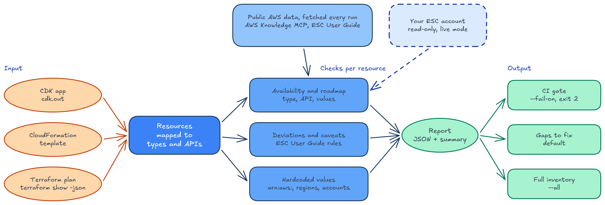

# esc-preflight

Find out what breaks before you deploy to the AWS European Sovereign Cloud (ESC). `esc-preflight` scans a CloudFormation template, a CDK app or a Terraform plan and reports:

* services and resource types that are not available in ESC
* features the [ESC User Guide](https://docs.aws.eu/esc/latest/userguide/services.html) documents as different, quoted with a link
* values ESC does not offer, such as instance types, engine versions and Bedrock models (live mode)
* values hardcoded for another partition, such as `arn:aws:`, `amazonaws.com` or `eu-central-1`

It runs locally and uses only public data plus, optionally, your own ESC account, read-only. It makes no model calls. Every run fetches from these hosts, so allow them for egress in CI: `pypi.org` (botocore version), `raw.githubusercontent.com` (botocore service data, HashiCorp provider data), `registry.terraform.io` (HashiCorp provider versions), `api.regional-table.region-services.aws.a2z.com` (AWS Services by Region) and `docs.aws.eu` (ESC endpoints page and User Guide). Live mode also calls the AWS API endpoints in `eusc-de-east-1`. The same input and the same upstream data always produce the same report.

## Quick start

Install [Rust](https://www.rust-lang.org/tools/install) 1.99 or later, then build and install from this repository:

```bash
cargo install --locked --git https://github.com/aws-samples/sample-esc-preflight --tag 0.1.1
```

Then scan:

```bash
# CDK app
cdk synth
esc-preflight scan cdk.out --detail gaps

# CloudFormation template
esc-preflight scan template.yaml --detail gaps

# Terraform
terraform plan -out=tfplan
terraform show -json tfplan | esc-preflight scan --detail gaps
```

The JSON report goes to stdout and a summary to stderr. In a terminal the summary uses symbols and color (`NO_COLOR` turns color off); piped or redirected, it is plain ASCII:

```
◆ esc-preflight · 172 resources · eusc-de-east-1
  botocore 1.44.1 · regional table 20251113063700 · live mode

  AVAILABILITY
  ✔ available          168
  ✘ not available        2   AWS::CodeCommit::Repository, AWS::DynamoDB::GlobalTable
  ? cannot assess        2   custom resources, backed by their own code

  PORTABILITY
  ⚠ hardcoded fields    15   6 resources: `arn:aws:`
  ✘ deviations           1   codepipeline source actions (ESC User Guide)

  REQUIRED CHANGES  3 flag · 15 fix
  ✘ flag     codecommit not available             → remove or replace codecommit
             AWS::CodeCommit::Repository
  ✘ flag     codepipeline source actions          → remove or replace the feature
             AWS::CodePipeline::Pipeline
  ✘ flag     dynamodb type not registered         → use AWS::DynamoDB::Table (single Region)
             AWS::DynamoDB::GlobalTable
  ● fix ×15  hardcoded `arn:aws:` in 6 resources  → `arn:${Aws.PARTITION}:`
```

## Fix what it finds

Every entry in `required_changes` has a tier:

| Tier | Meaning | Examples |
|---|---|---|
| `fix` | Apply as stated. The value stays the same where you deploy today. | `arn:aws:` becomes the partition, `amazonaws.com` the URL suffix |
| `propose` | One documented change, applied only after your yes. It states its precondition and consequence. | A DynamoDB global table becomes a table, an account ID in a hand-written template becomes `AWS::AccountId`, offered instance types to choose from (live mode) |
| `flag` | You decide. The tool cannot know your callers, data or dependencies. | Unavailable services, most documented deviations, a Region or account other than the stack's own |

Fixes and proposals carry `edits` with the replacement for CloudFormation, CDK and Terraform. CDK findings carry `cdk_path` to find the construct.

[`skills/esc-preflight/SKILL.md`](skills/esc-preflight/SKILL.md) is a skill for coding agents, in the Agent Skills format. It scans, applies fixes in your source code, asks before each proposal, writes flags to `ESC-GAPS.md` and rescans. It instructs the agent never to deploy or make write calls. Review the agent's changes before you commit them.

## Live mode (recommended)

```bash
esc-preflight scan cdk.out --mode live --profile <esc-profile>
```

Public sources list services, not resource types or property values. Live mode also checks an ESC account you own, read-only, and finds what public mode cannot:

* resource types missing from the account's CloudFormation registry, for example `AWS::DynamoDB::GlobalTable`
* Terraform resources and CDK `AwsCustomResource` calls, with one read call per service
* EC2 instance types, Availability Zones, Bedrock model and inference-profile IDs, and RDS and ElastiCache engine versions

Use [`iam/esc-preflight-readonly.json`](iam/esc-preflight-readonly.json) plus read access to the services in your input. The scanner calls `iam:ListAttachedRolePolicies` only on its own role, so you can replace the `OwnRolePolicies` resource with that role's ARN. The AWS managed `ReadOnlyAccess` policy also works, but grants far more than the scanner uses, including data reads.

## How it works



* **Availability:** each resource is mapped to its service. Offering sources (AWS Services by Region, the ESC User Guide) decide whether it is available. Endpoint sources (botocore, the [ESC endpoints page](https://docs.aws.eu/general/latest/gr/endpoints.html)) confirm it. When the sources disagree, the finding is disputed and every claim is shown.
* **Documented deviations:** rules tie a sentence of the ESC User Guide to the resources and properties that use the feature. A rule fires only while its sentence is on the live page.
* **Hardcoded values:** literal partitions, DNS suffixes, regions, zones and account IDs in resource properties and outputs are reported. Values that CDK synthesis or a Terraform plan wrote in for its own environment are reported once, under `environment_literals`.
* **Service principals:** ESC service principals use the same `<service>.amazonaws.com` form as the global partition (verified in an ESC account), so `lambda.amazonaws.com` is not flagged. A principal with another partition's suffix, such as `lambda.amazonaws.com.cn`, gets a fix. ESC uses separate accounts, so an `arn:aws:` principal with a literal account ID from another partition is flagged.

All sources are fetched on every run. If one fails or returns far less data than expected, the scan stops with exit code 3.

## Command reference

`esc-preflight scan [OPTIONS] [TEMPLATE]`

| Option | Default | Description |
|---|---|---|
| `TEMPLATE` | stdin | CloudFormation template (JSON or YAML), `cdk.out` directory, or `terraform show -json` output. `-` reads stdin. |
| `--mode public\|live` | `public` | `live` also checks an ESC account, read-only |
| `--profile <name>` | default chain | AWS profile for live mode |
| `--role-arn <arn>` | none | Role to assume for live mode, on top of the profile or default credentials |
| `--detail full\|gaps` | `full` | `full`: every resource with sources, verdict and data versions. `gaps`: only findings that need action |
| `--fail-on blocker\|hazard\|disputed` | none | Exit 2 when a matching finding exists. `blocker`: not available, a value the region does not offer, or a documented deviation |
| `--out <file>` | stdout | Write the JSON report to a file |
| `--target-region <region>` | `eusc-de-east-1` | Region to assess against. Other regions use fewer sources and get no documented deviations |
| `--timeout <seconds>` | `30` | Per-request timeout |
| `-q`, `--quiet` | | No summary on stderr |

| Exit code | Meaning |
|---|---|
| 0 | Report produced |
| 1 | Invalid input or arguments |
| 2 | A `--fail-on` finding exists |
| 3 | A data source failed |
| 4 | Live-mode authentication failed |

In CI, fail the build on blockers and keep the report as an artifact:

```bash
esc-preflight scan cdk.out --fail-on blocker -q --out esc-report.json
```

## Development

Tests, data maintenance and limitations: [docs/DEVELOPMENT.md](docs/DEVELOPMENT.md).

## Notice

This is sample code, for non-production usage. You should work with your security and legal teams to meet your organizational security, regulatory and compliance requirements before deployment. Third-party attributions are in [THIRD-PARTY-LICENSES](THIRD-PARTY-LICENSES).

## Security

See [CONTRIBUTING](CONTRIBUTING.md#security-issue-notifications) for more information.

## License

This library is licensed under the MIT-0 License. See the LICENSE file.

