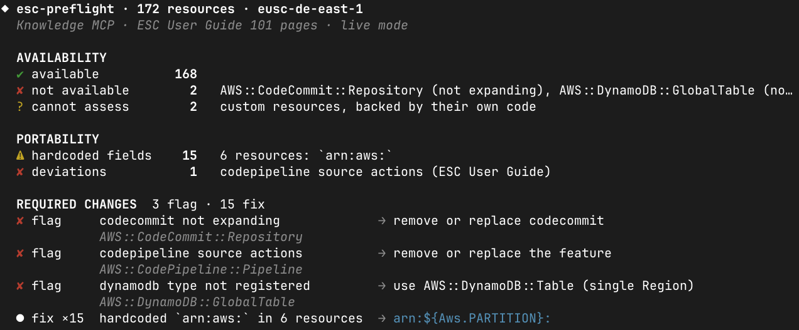

# 🛫 esc-preflight

Checks a CloudFormation template, CDK app or Terraform plan for compatibility with the AWS European Sovereign Cloud (ESC), before you deploy:

* resource types, services and API operations ESC does not offer, with their roadmap state (planned for a quarter, being planned, not expanding)
* features the [ESC User Guide](https://docs.aws.eu/esc/latest/userguide/services.html) documents as not available, and caveats for features that behave differently
* instance types, engine versions and node types ESC does not offer
* values hardcoded for another partition, such as `arn:aws:`, `amazonaws.com` or `eu-central-1`

It runs locally, read-only, and makes no model calls.



## What is this good for?

* Find out whether the IaC templates behind your AWS landing zone and cloud workloads deploy in ESC.
* Give your AI coding assistant a deterministic check for the IaC it writes, instead of relying on trial and error.
* Run `esc-preflight scan --fail-on blocker` in CI, so no pipeline ships a service, feature or value ESC does not offer.
* In an automated migration, scan, change and re-scan IaC code until no blockers remain, across repositories.

## Install

Requires [Rust](https://www.rust-lang.org/tools/install) 1.99 or later.

```bash
cargo install --locked --git https://github.com/aws-samples/sample-esc-preflight --tag 0.2.0
```

## Scan

Run in your project directory:

| Input | Command |
|---|---|
| CDK app | `AWS_REGION=eusc-de-east-1 cdk synth && esc-preflight scan` |
| CloudFormation | `esc-preflight scan template.yaml` |
| Terraform | `terraform plan -out=tfplan && terraform show -json tfplan \| esc-preflight scan` |

* Without a path, `scan` reads `cdk.out` or the single template in the current directory.
* The summary goes to stderr. The JSON report goes to `--out <file>`, or to stdout when it is redirected.
* Add `--profile <esc-profile>` to also check your ESC account (live mode, recommended).

## How it works


## Read the report

Each entry in `required_changes` has a tier:

| Tier | Meaning | Example |
|---|---|---|
| `fix` | Apply as stated; nothing changes where you deploy today | `arn:aws:` becomes the partition |
| `propose` | Apply after review; states precondition and consequence | a global table becomes a table, an instance type the region offers |
| `flag` | Your decision | an unavailable service, a documented deviation |

`edits` carry the replacement for CloudFormation, CDK and Terraform; `cdk_path` locates the CDK construct.

These findings never block:

| Finding | Meaning | What to do |
|---|---|---|
| disputed | The type exists in ESC, the service is not launched yet (for example CloudFront) | Test before relying on it |
| caveat | The feature works with a documented ESC difference | Read the quoted sentence |
| guide conflict | The ESC User Guide says not available, the availability data says available | Ask your AWS team to confirm and correct the guide |

## Live mode

```bash
esc-preflight scan --profile <esc-profile>
```

`--profile`, `--role-arn` or `--live` (default credential chain) turn it on. Live mode reads your ESC account and overrides the public data. It also checks Availability Zones and Bedrock models.

Permissions: [`iam/esc-preflight-readonly.json`](iam/esc-preflight-readonly.json) plus read access to the services in your input. `ReadOnlyAccess` also works, but grants far more.

## Agent skill

[`skills/esc-preflight/SKILL.md`](skills/esc-preflight/SKILL.md) lets a coding agent scan, apply fixes in your source, ask before each proposal, write flags to `ESC-GAPS.md` and rescan. It never deploys. Review its changes before you commit.

## Options

`esc-preflight scan [OPTIONS] [PATH]`

| Option | Default | Description |
|---|---|---|
| `PATH` | current directory or stdin | Template, CDK app or `cdk.out`, or `terraform show -json` output; `-` reads stdin |
| `--profile <name>` | | AWS profile; turns on live mode |
| `--role-arn <arn>` | | Role to assume; turns on live mode |
| `--live` | | Live mode with the default credential chain |
| `--all` | | Report every resource, not only gaps |
| `--fail-on blocker\|hazard\|disputed` | | Exit 2 on a matching finding; `disputed` includes guide conflicts |
| `--out <file>` | stdout when redirected | JSON report file |
| `--region <region>` | `eusc-de-east-1` | Region to check against |
| `--timeout <seconds>` | `60` | Per-request timeout |
| `-q`, `--quiet` | | No summary |

Exit codes: `0` report produced, `1` invalid input, `2` `--fail-on` matched, `3` a data source failed, `4` live-mode authentication failed.

CI example:

```bash
esc-preflight scan --fail-on blocker -q --out esc-report.json
```

## Network access

Every run fetches current data, with no cache. Allow these hosts:

| Host | Data |
|---|---|
| `knowledge-mcp.global.api.aws` | Availability and roadmap ([AWS Knowledge MCP server](https://awslabs.github.io/mcp/servers/aws-knowledge-mcp-server)) |
| `docs.aws.eu` | ESC User Guide |
| `registry.terraform.io`, `raw.githubusercontent.com` | Terraform provider data, Terraform input only |
| AWS endpoints in `eusc-de-east-1` | Live mode only |

The Knowledge MCP server is rate-limited. A scan makes 5 to 30 calls, two at a time; inputs with instance types or engine versions need the most. The scanner waits when the server asks it to.

## Development

Tests, data maintenance and limitations: [docs/DEVELOPMENT.md](docs/DEVELOPMENT.md).

## Notice

This is sample code, for non-production usage. You should work with your security and legal teams to meet your organizational security, regulatory and compliance requirements before deployment. Third-party attributions are in [THIRD-PARTY-LICENSES](THIRD-PARTY-LICENSES).

## Security

See [CONTRIBUTING](CONTRIBUTING.md#security-issue-notifications) for more information.

## License

This library is licensed under the MIT-0 License. See the LICENSE file.
