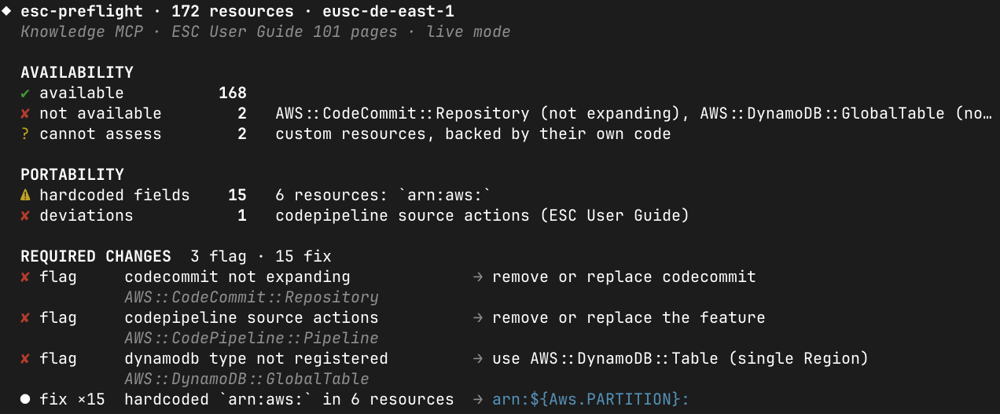
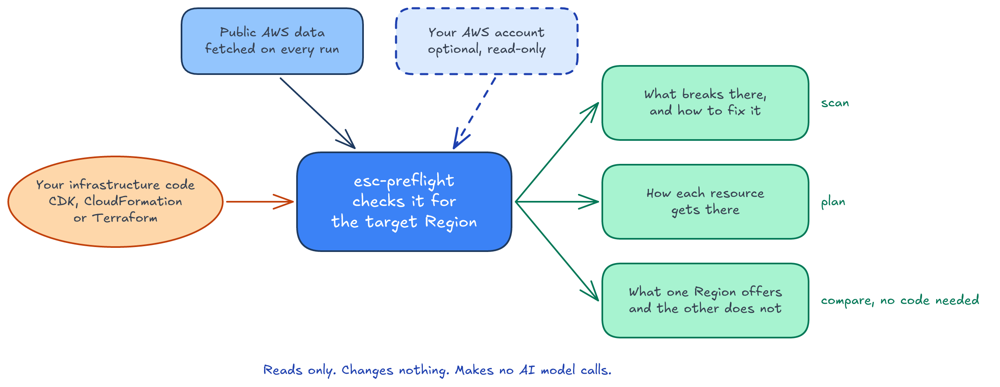

# 🛫 esc-preflight

Checks a CloudFormation template, CDK app or Terraform plan for compatibility with the AWS European Sovereign Cloud (ESC), or any other target Region, before you deploy:

* resource types, services and API operations the target does not offer, with their roadmap state (planned for a quarter, being planned, not expanding)
* features the [ESC User Guide](https://docs.aws.eu/esc/latest/userguide/services.html) documents as not available, and caveats for features that behave differently
* instance types, engine versions, node types, the Lambda `arm64` architecture and resource properties the target does not offer
* Lambda runtimes that can no longer be created, and dependencies that stay outside the target, such as a CloudFront certificate in us-east-1
* hardcoded Regions, zones, partitions, DNS suffixes, accounts and resource IDs, such as `arn:aws:`, `amazonaws.com`, `eu-central-1` or `ami-0abc...`, including values for the target itself
* in live mode, the target account: Region opt-in, quotas, service control policies and public SSM parameters

Two more commands help plan a move: `plan` says how each resource reaches the target (redeploy, replicate, restore) in waves, and `compare` lists what one Region offers and another does not.

It runs locally, read-only, and makes no model calls.



## What is this good for?

* Find out whether the IaC templates behind your AWS landing zone and cloud workloads deploy in ESC.
* Give your AI coding assistant a deterministic check for the IaC it writes, instead of relying on trial and error.
* Run `esc-preflight scan --fail-on blocker` in CI, so no pipeline ships a service, feature or value ESC does not offer.
* In an automated migration, scan, change and re-scan IaC code until no blockers remain, across repositories.
* Plan the move of a workload: which resources redeploy, which need their data replicated or restored, and in which order.
* Compare two Regions before you choose one.
* Move between any Regions or partitions, not only to ESC: `--region eu-west-1` for a move within the global partition, `--region us-gov-west-1` for AWS GovCloud (US), or `--region cn-north-1` for AWS China. ESC User Guide checks apply to ESC targets only.

## Install

Requires [Rust](https://www.rust-lang.org/tools/install) 1.99 or later.

```bash
cargo install --locked --git https://github.com/aws-samples/sample-esc-preflight --tag 0.3.1
```

## Scan

Run in your project directory:

| Input | Command |
|---|---|
| CDK app | `AWS_REGION=eusc-de-east-1 cdk synth && esc-preflight scan` |
| CloudFormation | `esc-preflight scan template.yaml` |
| Terraform | `terraform plan -out=tfplan && terraform show -json tfplan \| esc-preflight scan` |

* Without a path, `scan` reads `cdk.out` or the single template in the current directory.
* AWS SAM templates are read as the CloudFormation they deploy: `Globals` apply, and each SAM resource is checked as its base type (an `AWS::Serverless::Function` as an `AWS::Lambda::Function`) with the properties SAM passes through. Hardcoded values in `Globals` are reported at `Globals/<section>`. Resources SAM generates from event sources are not checked; scan the processed template for those.
* For a target other than ESC, add `--region <region>` and synthesize or plan for that Region.
* For a move to another account, add `--account <id>`: account IDs other than the target's and the input's own then break.
* The summary goes to stderr. The JSON report goes to `--out <file>`, or to stdout when it is redirected.
* Add `--profile <profile>` to also check your account in the target (live mode, recommended).

## Plan

```bash
esc-preflight plan template.yaml --from eu-central-1 --region eusc-de-east-1 --out plan.json
```

`plan` runs the scan, then gives every resource a path, the mechanism rule that moves it (`rule`, a key of `mechanisms`) and what happens to its data (`data_action`):

| Path | Meaning |
|---|---|
| `redeploy` | Deploy the input again in the target |
| `replicate` | A service mechanism copies the content, such as S3 Replication or a DynamoDB global table replica |
| `restore` | Copy a snapshot, backup or export and restore it, such as an RDS snapshot copy |
| `blocked` | A scan finding blocks the resource: not available, a documented deviation, a value or property the target does not offer, or a failed account check |
| `unknown` | No rule covers the resource type, or its mechanism does not work across the partitions of the move; this does not mean there is no way to move it |

| Data | Meaning |
|---|---|
| `migrate` | Move the data with the resource |
| `recreate` | Create new content in the target, such as a new KMS key, and re-encrypt under it |
| `drain` | Let the source empty before switching over, such as an SQS queue |
| `leave` | Keep the history in the source, such as a log group |

* The source Region is `--from`, else the input's environment (a CDK assembly or Terraform plan states it). Pass `--from` when you produced the input for the target, as for `scan`. Without a source, or with the target as source, the plan applies no partition limits and says so in a warning.
* `mechanisms` describes each rule once: the mechanism (`via`), where the resource lives (`scope`), what it holds (`holds`), the AWS page (`doc`), and `works_across_partitions`, which is absent where the AWS documentation does not say. For a move to another partition, a mechanism that is not documented there takes its documented alternative, the rule's `fallback` (DynamoDB export and import, a new KMS key, an EC2 AMI stored and restored through S3), and the resource says `fallback: true`; without one, the resource becomes `unknown` with a note (S3, EFS, Secrets Manager and ECR replication, RDS snapshot copy).
* Resources come in waves (`wave`; a `blocked` resource has none): foundation (network, identity, keys) from wave 1, shared services from wave 2, workloads from wave 3, and each resource after the resources it references: in its stack (`Ref`, `Fn::GetAtt`, `Fn::Sub`, `DependsOn`), in other stacks (`Fn::ImportValue`, nested-stack outputs), and in a Terraform plan (references, `depends_on`, module inputs and outputs, data sources). A reference cycle gets a warning.
* Findings on the whole input, such as a quota, are one warning that blocks everything until resolved. Dependencies and hardcoded literals do not block; fix them as the scan says.
* The scan options apply to the scan `plan` runs; `--out` takes the plan JSON. `plan` executes nothing and exits 0 whenever it produced a plan.

The mechanism rules cover the most frequent resource types. Each rests on a quoted sentence of the AWS documentation.

## Compare

```bash
esc-preflight compare --from eu-central-1 --to eusc-de-east-1
```

`compare` lists what `--from` offers and `--to` does not: products and features with their roadmap state in `--to`, CloudFormation resource types, config values such as instance types and engine versions, and top-level properties of types both offer. It does not list the reverse.

* Public mode reads both Regions from the public sources under [Network access](#network-access) and compares properties where both Regions publish a CloudFormation schema bundle: the global partition, AWS GovCloud (US) and AWS China. ESC publishes none, so public mode skips properties for it with a warning.
* With `--live`, `--profile` or `--role-arn` for `--to`, its CloudFormation registry comes from the account (`cloudformation:ListTypes`). Add `--properties` to read its resource schemas as well (`cloudformation:DescribeType`), which takes several minutes for about 700 types. Without `--properties`, a `--to` that publishes a schema bundle still has its properties compared.
* AWS China publishes no product or config value data, so a comparison with a China Region covers resource types and properties. A `--to` that no public source covers needs live mode, and then only types and properties are compared.
* The JSON groups products by their state in `--to` and resource types by product, and splits each config value key into `resource_type` and `property`.
* The terminal shows the first 8 entries of each list; the JSON has all of them.

## How it works



## Read the report

Each entry in `required_changes` has a tier:

| Tier | Meaning | Example |
|---|---|---|
| `fix` | Apply as stated; nothing changes where you deploy today | `arn:aws:` becomes the partition |
| `propose` | Apply after review; states precondition and consequence | a global table becomes a table, an instance type the region offers |
| `flag` | Your decision | an unavailable service, a documented deviation, a dependency |

Changes that make the same decision form one entry, and `targets` lists the resources it applies to. A target's `places` say where: the property `path`, the literal to `find`, and the `replace` expression for the kind of input (`run.input_kind`: `cdk-assembly`, `cloudformation`, `sam` or `terraform-plan`). A place without `replace` is for you to decide, or to choose among `candidates`; `within` then shows the whole value the literal sits in. `cdk_path` locates the CDK construct. Each required change states its `cause` and what decided it (`decided_by`: the public availability data, live mode, the target's resource schema, the ESC User Guide, a rule with a quoted AWS source, or the scanner itself). An unavailable service or a documented deviation can carry `mitigations`: another AWS service, a self-managed build or the service in another partition, each with its trade-offs, the AWS page that describes it, and `validation` (`documented` by AWS, or `field-proven`). The terminal shows the first as "known mitigation".

Hardcoded literals have a kind: `arn-partition`, `dns-suffix`, `dual-stack-suffix`, `service-principal`, `region-literal`, `availability-zone`, `account-id`, `resource-id` (such as `ami-`, `subnet-` or `sg-` IDs, which exist in one Region and account) and `legacy-endpoint` (such as dash-Region S3 hosts). Each has an `impact`: `breaks` when it names another Region, partition, account or resource, `portability` when it is right for the target but ties the input to it. Account IDs are found in ARNs, in the policies and Lambda permissions the input writes out (AWS principals, account condition keys such as `aws:SourceAccount`) and in ECR registry hosts. Zone IDs, resource IDs and other partitions' service principals always break; an account ID breaks next to another partition's ARN prefix, or when `--account` names a different one. A required change for hardcoded literals carries the same `impact`, `breaks` if any of its literals breaks; `summary.hazards_breaking` and `summary.hazards_portability` count the two. Other causes have no `impact`. A Region a property requires, such as us-east-1 for a CloudFront certificate, is not a hazard there.

Other findings:

| Finding | Meaning | What to do |
|---|---|---|
| depth blocker, `property` | A top-level property the target's CloudFormation schema of the type lacks | Remove the property, or keep the resource out of the target |
| dependency | Something the resource needs stays outside the target, or a fixed S3 bucket name is taken in the partition | Decide as the change says; it counts as a hazard for `--fail-on` |
| account blocker | Live mode: a quota the input and the account's current use exceed, an SCP that denies the Region or a service, a missing public SSM parameter | Raise the quota, ask your administrators, or choose another parameter |
| disputed | The type exists in the target, but the service is planned or being planned there | Test before relying on it |
| caveat (`caveats`) | The feature works with a documented difference, or a Lambda runtime is deprecated | Read the quoted sentence |
| guide conflict (`caveats`, with `conflict`) | The ESC User Guide says not available, the availability data says available | Ask your AWS team to confirm and correct the guide |

Disputed findings, caveats and guide conflicts never block.

## JSON report

Each command writes JSON that follows its schema and states its `schema_version`: [`schema/report.schema.json`](schema/report.schema.json) for `scan`, [`schema/plan.schema.json`](schema/plan.schema.json) and [`schema/compare.schema.json`](schema/compare.schema.json). A new field or enum value keeps the version; a removed or renamed field, or one whose meaning changes, increments it.

* The JSON is compact; add `--pretty` to indent it.
* A key whose value would be null or an empty list is left out: read a missing list as empty.
* All three commands start with the same `run` block (`mode`: `public` or `live`, and `target_region`; `input_kind` for scan and plan, `source_region` for plan and compare) and `sources` block (the URLs and versions of the data, and `fetched_at`).
* `scan` lists only resources that need action or verification in `findings`. With `--all`, `available` adds every available resource, logical IDs by resource type, and `documented_differences` every difference the ESC User Guide documents for the services in the input.
* A finding has `evidence` only where live mode ran or a source disagrees with the verdict.

For automation, read codes, enum values, ids and counts: `outcome` holds the `--fail-on` decisions, each warning has a `code`, and `items` where it names types, values, rules, checks or Regions, each required change a `cause`. Text fields (`note`, `reason`, `change`, `precondition`, `consequence`, `documented`, warning `message`) can change in any release.

## Live mode

```bash
esc-preflight scan --profile <profile>
```

`--profile`, `--role-arn` or `--live` (default credential chain) turn it on. Live mode reads your account in the target Region and overrides the public data. It also checks Availability Zones, Bedrock models, RDS DB instance classes for the engine (`rds:DescribeOrderableDBInstanceOptions`) and resource properties (`cloudformation:DescribeType`), and runs account checks:

* **Region opt-in**: the Region's status from `ec2:DescribeRegions`. A Region that is not enabled for the account fails at the first call, with a hint.
* **Quotas**: the input's VPCs, internet gateways, Elastic IPs and Lambda reserved concurrency, plus what the account already uses in the target (`used`, from `ec2:DescribeVpcs`, `ec2:DescribeInternetGateways`, `ec2:DescribeAddresses` and `lambda:GetAccountSettings`), against the account's quotas from Service Quotas. `needed` is what the input needs; Lambda keeps 100 units unreserved; resources under CloudFormation conditions count.
* **Service control policies**: read from AWS Organizations, which works only from the management account or a delegated administrator; elsewhere the check is skipped with a warning. Deny statements with an `aws:RequestedRegion` condition are evaluated for the target Region. Services the CloudFormation, CDK or SAM input uses are checked against allow lists (every level of the organization must allow a service on all resources) and against unconditional `Deny` statements, also with `NotAction`. SCPs do not affect the management account.
* **Public SSM parameters**: `/aws/service/...` parameters the input resolves, from parameter defaults (CDK writes these for the latest AMI) and `{{resolve:ssm:...}}` references, must exist in the target.

A check the role cannot read is skipped, with the reason, as an `account-checks-skipped` warning.

Permissions: [`iam/esc-preflight-readonly.json`](iam/esc-preflight-readonly.json) plus read access to the services in your input. Its `OrganizationsRead` statement is optional and only takes effect in the management or a delegated administrator account. `ReadOnlyAccess` also works, but grants far more. Live mode needs one profile, for the target.

## Agent skill

[`skills/esc-preflight/`](skills/esc-preflight/SKILL.md) lets a coding agent take your IaC to a target Region: it scans, applies fixes in your source, asks before each proposal, records flags in `PREFLIGHT-GAPS.md` and rescans. It never deploys or commits. Review `git diff` before you commit.

Copy the folder into your project, or into the same folder under your home directory:

| Harness | Folder |
|---|---|
| Claude Code | `.claude/skills/esc-preflight/` |
| Kiro | `.kiro/skills/esc-preflight/` |
| Codex, GitHub Copilot, Cursor, Gemini CLI | `.agents/skills/esc-preflight/` |

For a harness without skill support, copy the folder to `.agents/skills/esc-preflight/` and add this to your `AGENTS.md`:

```markdown
To prepare infrastructure code for another AWS Region or partition, follow .agents/skills/esc-preflight/SKILL.md.
```

The skill can also use the [AWS Knowledge MCP server](https://awslabs.github.io/mcp/servers/aws-knowledge-mcp-server) to research flags, for example where a substitute service is available. It needs no AWS account:

```json
{ "mcpServers": { "aws-knowledge-mcp-server": { "url": "https://knowledge-mcp.global.api.aws", "type": "http" } } }
```

The server's answers go into the gap register; the scanner's report alone decides what the agent edits.

## Options

`esc-preflight scan [OPTIONS] [PATH]`

| Option | Default | Description |
|---|---|---|
| `PATH` | current directory or stdin | Template, CDK app or `cdk.out`, or `terraform show -json` output; `-` reads stdin |
| `--profile <name>` | | AWS profile; turns on live mode |
| `--role-arn <arn>` | | Role to assume; turns on live mode |
| `--live` | | Live mode with the default credential chain |
| `--account <id>` | | Account the input moves to; other accounts' IDs then break |
| `--all` | | Report every resource, not only gaps, and every documented difference of the input's services |
| `--fail-on blocker\|hazard\|disputed` | | Exit 2 on a matching finding; `hazard` includes `portability` literals and dependencies, `disputed` includes guide conflicts |
| `--out <file>` | stdout when redirected | JSON report file |
| `--pretty` | | Indent the JSON report |
| `--region <region>` | `eusc-de-east-1` | Region to check against |
| `--timeout <seconds>` | `60` | Per-request timeout |
| `-q`, `--quiet` | | No summary |

`esc-preflight plan [OPTIONS] [PATH]` takes the scan options and `--from <region>`, the Region the workload runs in today; it overrides the Region the input was produced for. `--out` takes the plan JSON; `--fail-on` and `--all` are rejected.

`esc-preflight compare --from <region> --to <region>` takes `--live`, `--profile`, `--role-arn` and `--properties` (for `--to`), `--out`, `--pretty`, `--timeout` and `--quiet`.

Exit codes: `0` report produced, `1` invalid input, `2` `--fail-on` matched (`scan` only), `3` a data source failed, `4` live-mode authentication failed.

CI example:

```bash
esc-preflight scan --fail-on blocker -q --out esc-report.json
```

## Network access

Every run fetches current data, with no cache. Allow these hosts:

| Host | Data |
|---|---|
| `prod.capabilities.builder.aws.com` | Products with roadmap states, CloudFormation resource types and config values for every Region of the run (the data behind [AWS Capabilities by Region](https://builder.aws.com/build/capabilities)) |
| `knowledge-mcp.global.api.aws` | API availability, the not-expanding state of products, and products the capabilities API does not list ([AWS Knowledge MCP server](https://awslabs.github.io/mcp/servers/aws-knowledge-mcp-server)); everything when the capabilities API fails |
| `docs.aws.eu` | ESC User Guide, ESC targets only |
| `schema.cloudformation.<region>.amazonaws.com` (`.amazonaws.com.cn` in China) | The Region's CloudFormation resource schemas, for property checks in public mode, and the resource types of AWS China; not for ESC |
| `raw.githubusercontent.com` | AWS SDK endpoint data (botocore `endpoints.json`) for AWS China targets; Terraform provider type maps for Terraform input |
| `registry.terraform.io` | Terraform provider versions, Terraform input only |
| AWS endpoints in the target Region | Live mode only; Organizations in the partition's Organizations Region |

The public sources are not always up to date, and they can disagree. Where you have read access to an account in the target Region, use live mode: it reads the target itself and overrides the public data.

AWS China publishes no product, roadmap or config value data, so a public-mode scan for China reports the instance types and engine versions it did not check (warning `values-unchecked`).

Outside China, a scan also asks the Knowledge MCP server for the input's resource types, and a type is available when either source says so. When the capabilities API fails, the run prints a note and reads CloudFormation from the Knowledge MCP server, which is slower. The Knowledge MCP server is rate-limited; the scanner runs up to eight calls at a time and fewer when the server asks it to wait. A failed download of a schema bundle fails the run (exit 3).

## Related AWS resources

esc-preflight checks your IaC. These public AWS resources cover what it does not:

* [Capability Insights for AWS](https://docs.aws.amazon.com/solutions/capability-insights-for-aws/) ([source](https://github.com/aws/capability-insights-for-aws)): a Regional availability dashboard you deploy in your own account, including Region-scoped IAM policies and SCPs.
* [Sample Service Quotas Replicator for AWS](https://github.com/aws-samples/sample-service-quotas-replicator-for-aws): compares service quotas between accounts and Regions.
* [Workload Discovery on AWS](https://aws.amazon.com/solutions/implementations/workload-discovery-on-aws/): maps the resources a workload runs today, including those not in IaC.
* [CloudFormation IaC generator](https://docs.aws.amazon.com/AWSCloudFormation/latest/UserGuide/generate-IaC.html) and [AWS Resource Explorer](https://docs.aws.amazon.com/resource-explorer/latest/userguide/welcome.html): find resources that are not in IaC yet and generate templates for them, which esc-preflight can then scan.
* [Considerations for migrating workloads between AWS Regions](https://aws.amazon.com/blogs/mt/considerations-for-migrating-workloads-between-aws-regions/): what to plan beyond the IaC within a partition, such as costs, the foundation in the target Region and the migration path per service.

## Development

Tests, data maintenance and limitations: [docs/DEVELOPMENT.md](docs/DEVELOPMENT.md).

## Notice

This is sample code, for non-production usage. You should work with your security and legal teams to meet your organizational security, regulatory and compliance requirements before deployment. Third-party attributions are in [THIRD-PARTY-LICENSES](THIRD-PARTY-LICENSES).

## Security

See [CONTRIBUTING](CONTRIBUTING.md#security-issue-notifications) for more information.

## License

This library is licensed under the MIT-0 License. See the LICENSE file.
